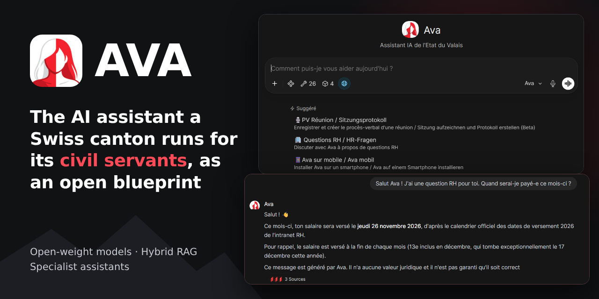
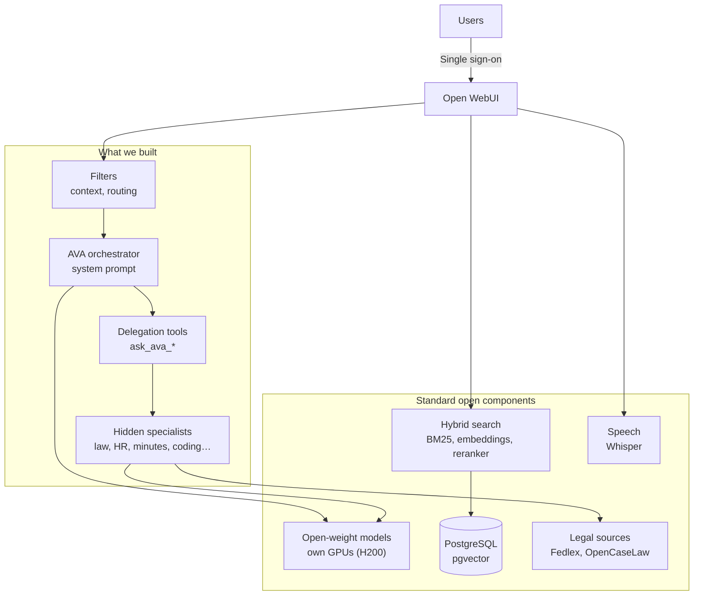

<p align="center">
  
</p>

<h1 align="center">AVA</h1>

<p align="center">
  <strong>The AI assistant a Swiss canton runs for its civil servants: architecture, tools, filters and system prompts, built on Open WebUI.</strong>
</p>

<p align="center">
  <a href="#start-here">Start here</a> ·
  <a href="docs/build-guide.md">Build guide</a> ·
  <a href="docs/architecture.md">Architecture</a> ·
  <a href="#whats-in-this-repository">What's inside</a> ·
  <a href="#licences">Licences</a>
</p>

AVA (*Assistant Valaisan Augmenté*) is the AI platform of the State of Valais, Switzerland. Civil servants use it to draft, summarise, search documents, ask legal and HR questions, and turn recordings into meeting minutes. More than 2,000 people tested it during the pilot, before its first production version in November 2026.

AVA is not a fork or a new chat product. It is a configuration of [Open WebUI](https://github.com/open-webui/open-webui), open-weight models and our own extensions. We publish our work so that other administrations and organisations can reproduce it.

## Architecture



**The key idea is one assistant with hidden specialists.** Users talk to a single assistant and never choose a model. When a question needs expertise, the orchestrator calls a tool such as `ask_ava_juriste`. That tool runs a hidden specialist model, with its own prompt, tools and knowledge, on the user's behalf, and returns the answer with its sources.

Adding a specialist needs no new infrastructure: a workspace model, a system prompt, and a copy of the delegation tool.

## Start here

| If you want to… | Read | Time |
|---|---|---|
| See the pattern working on a laptop | [Build guide, part 1](docs/build-guide.md#part-1-try-it-on-a-laptop) | 30 minutes |
| Understand how a question travels | [Architecture](docs/architecture.md) | 15 minutes |
| Build it for production | [Build guide, part 2](docs/build-guide.md#part-2-build-it-for-production) | A few days |
| Choose models, hosted or on your GPUs | [Models](docs/models.md) | 15 minutes |
| Keep it running | [Operations](docs/operations.md) | 20 minutes |
| Add a chatbot to your public website | [Website chatbot](docs/website-chatbot.md) | 15 minutes |
| Turn recordings into minutes | [Meeting minutes](docs/meeting-minutes.md) | 15 minutes |

The quickest look:

```bash
git clone https://github.com/SCI-KDI/AVA.git && cd AVA
cp .env.example .env        # then change both secrets
docker compose up -d
```

Then open <http://localhost:3000>. This local stack uses a small model, and does not include our extensions until you install them: [part 1 of the build guide](docs/build-guide.md#part-1-try-it-on-a-laptop) walks you through it.

## What's in this repository

| Path | Contents | How you use it |
|---|---|---|
| [`tools/ask_ava_specialist.py`](tools/ask_ava_specialist.py) | The delegation tool: runs a hidden specialist and returns its answer and sources | One copy per specialist, in **Workspace > Tools** |
| [`filters/ava_context_injector.py`](filters/ava_context_injector.py) | User's name and today's date in the prompt; conversation snapshot for tools | Global function, in **Admin Panel > Functions** |
| [`filters/intent_router.py`](filters/intent_router.py) | Rewrites follow-ups and suggests a specialist, with one small model call | Function attached to the orchestrator |
| [`system-prompts/`](system-prompts/) | Prompts for the orchestrator and four specialists, in French | Paste into each model, then adapt |
| [`docs/`](docs/) | Build guide, architecture, models, operations, website chatbot, meeting minutes | Read in the order above |
| [`deploy/`](deploy/) | Example Helm values and Secret | Copy, then fill in your values |
| [`compose.yaml`](compose.yaml) | Local evaluation stack | `docker compose up -d` |

Some of our extensions are not published yet, because their configuration is still specific to our network: legal search tools, file extraction, the meeting-minutes tool, the voice recorder and the website gateway. The documentation describes how each works, so that you can build your own, and points to public alternatives where they exist.

Our prompts and some tools refer to Valais law and institutions. Treat them as working examples, and have a specialist in your own domain test them before use.

## Licences

**Our work in this repository, including tools, filters and system prompts, is under the [Apache License 2.0](LICENSE).**

**Open WebUI is not.** It has [its own licence](https://github.com/open-webui/open-webui/blob/main/LICENSE), which is not OSI-approved. Above 50 users in a rolling 30-day period, you may not change or remove its branding without written permission or an enterprise licence. This repository contains no Open WebUI code. Models, services and other components also have their own licences and terms: see [third-party licences](docs/third-party-licenses.md).

## Status and contributions

AVA is maintained by a small public-sector team: the AI Unit of the Cantonal IT Service (SCI), State of Valais. We publish it for reuse and transparency, and we cannot provide support for other deployments.

Issues and pull requests are welcome: see [CONTRIBUTING.md](CONTRIBUTING.md). Please report vulnerabilities privately, as described in [SECURITY.md](SECURITY.md). If you reuse AVA, please tell us in an issue: it helps us justify continued publication.

This repository is not legal advice or a compliance certification. Each organisation remains responsible for its own legal and security assessment.
