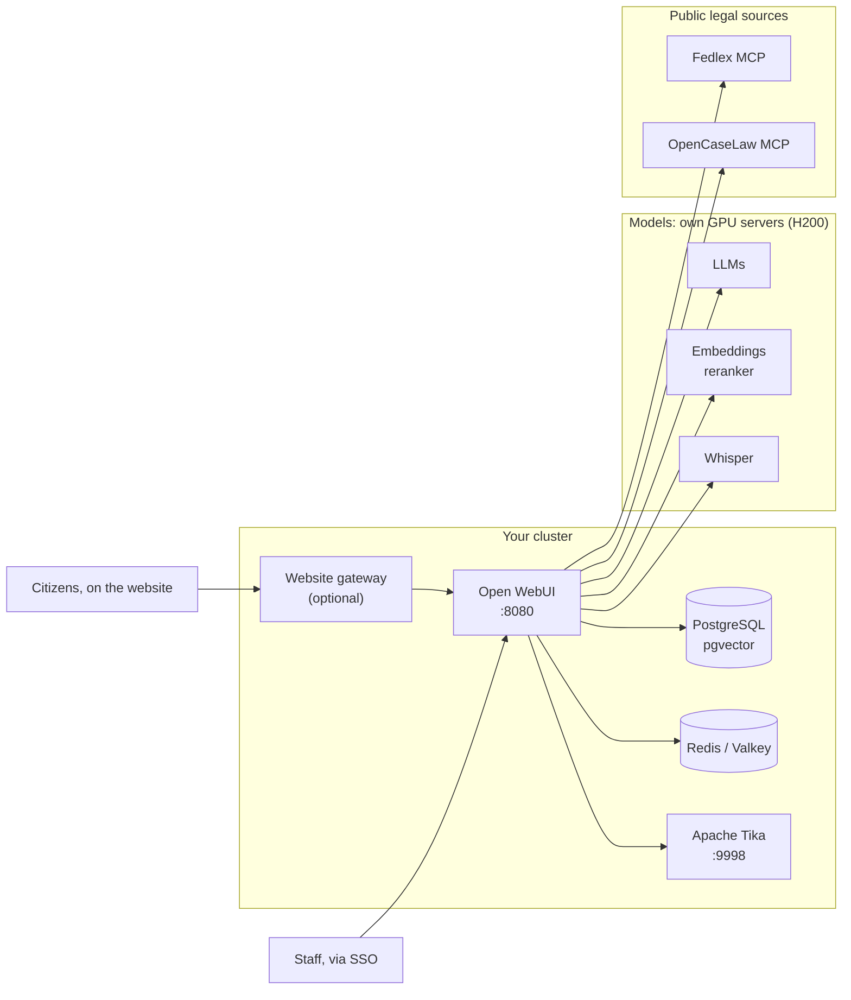
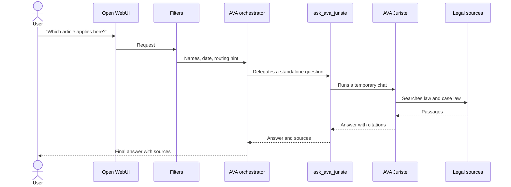
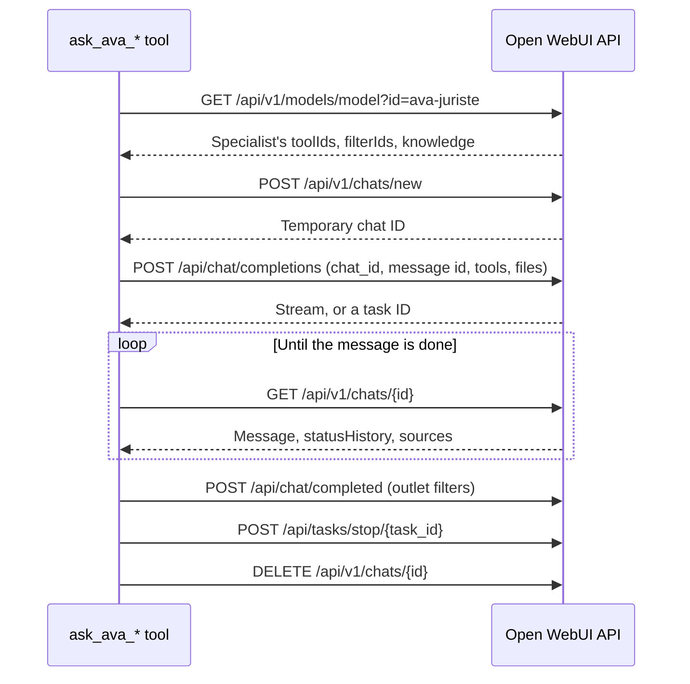

# Architecture

AVA adds three things to a standard Open WebUI deployment: **filters**, **tools** and **system prompts**. Everything else is an existing open component that can be replaced.

## Components

| Layer | In AVA | Replaceable by |
|---|---|---|
| Interface and accounts | Open WebUI, OIDC sign-on with groups | Another Open WebUI configuration |
| Behaviour (our code) | Filters, tools, system prompts | Your own versions |
| Language models | Open-weight models on our own NVIDIA H200 GPU servers, behind an OpenAI-compatible API | Any compatible server, including a hosted provider such as a Swiss cloud |
| Document search | Hybrid BM25 and `bge-multilingual-gemma2` embeddings, `bge-reranker-v2-m3`, pgvector | Other embeddings or vector databases |
| Files | Apache Tika, OCR, a vision model for scans | Other extraction engines |
| Legal sources | Fedlex and OpenCaseLaw MCP servers, cantonal laws in a knowledge base | Your country's sources |
| Speech | Whisper | Any OpenAI-compatible speech server |
| Platform | OpenShift with Helm, one replica, Redis | Any Kubernetes cluster |

## How a question travels

1. **Open WebUI** authenticates the user and receives the message.
2. **Filters** prepare the request, in order of priority:

   | Priority | Filter | Effect |
   |---|---|---|
   | -100 | [Context injector](../filters/ava_context_injector.py) | Fills name placeholders, adds the date, snapshots the conversation |
   | 0 to 2 | File extraction (not yet published) | Maps the text of uploaded files and images |
   | 5 | [Intent router](../filters/intent_router.py) | Rewrites follow-ups, suggests a specialist |

3. **The orchestrator** answers directly, or calls a delegation tool. It decides from the tool docstrings, its system prompt, and the router's hint.
4. **A delegation tool** runs the specialist on the user's behalf.
5. **The specialist** uses its own prompt, tools and knowledge, then writes a sourced answer.
6. **The orchestrator** returns that answer to the user, with its sources.

## Open WebUI building blocks

| Block | What it does | Used in AVA for |
|---|---|---|
| **Workspace model** | A base model plus a prompt, tools, knowledge and parameters | The orchestrator and each specialist |
| **Tool** | Python function the model decides to call | Delegation, legal search, documents |
| **Filter** | Python code that runs on every matching request or response | Context, routing, file extraction, spelling |
| **Valves** | Admin settings for a tool or filter | Model IDs, URLs, timeouts, API keys |
| **Knowledge** | Indexed document collection | Cantonal laws, HR directives |
| **External tools (MCP)** | Tools served by another server | Fedlex, OpenCaseLaw |

## How delegation works

A delegation tool is an Open WebUI tool that calls Open WebUI's own API, with the current user's token. The specialist therefore runs with the user's permissions, and its usage is attributed to the user.

The steps that matter:

1. **Read the specialist's configuration.** A completion called through the API does not apply the model's tools and filters automatically. The tool reads them from the model record, then passes `tool_ids` and `filter_ids` explicitly.
2. **Create a temporary chat.** It holds a user message and an empty assistant message, so that Open WebUI has somewhere to write the answer.
3. **Prepare the question.** The temporary chat does not go through the orchestrator's inlet filters, so the tool adds what the specialist would otherwise miss: a language directive, today's date, and an optional tool budget. Without the date, our legal specialist reasoned from its training date.
4. **Send context by reference.** The last few turns are forwarded without reasoning traces. Attached files are forwarded as references; the specialist's own filters read their content.
5. **Mark the request.** `variables.carryover_filter_skip = "true"` tells the intent router not to reroute the question. It must be a string, because Open WebUI substitutes variables with `str.replace()`.
6. **Wait for the authoritative answer.** With a chat ID and message ID, Open WebUI may run the completion as a background task. The tool then reads the chat until the message is marked `done`. Recent versions store the text in the message's `output[]` items, not only in `content`.
7. **Relay progress and sources.** The specialist's tool statuses are shown to the user while it works. Its citations are re-emitted in the orchestrator's chat.
8. **Run the outlet filters**, with `POST /api/chat/completed`. Otherwise filters such as spelling fixes never run on the specialist's answer.
9. **Clean up, even on errors or cancellation.** The tool stops the remaining tasks, deletes the temporary chat, and checks that it is gone.

Adding a specialist therefore needs no new infrastructure: a workspace model, a system prompt, and a copy of the delegation tool with its own valves and docstring.

The meeting-minutes specialist shows a useful variant. Its tool transcribes the recording before delegating, because the file is attached to the orchestrator's chat, and the specialist only needs the text. See [meeting minutes](meeting-minutes.md).

### Shared metadata

Filters and tools pass information through the request's `metadata` dictionary. Open WebUI hands the same object to the tools, so filters must change it in place rather than replace it.

| Key | Written by | Read by | Content |
|---|---|---|---|
| `_ava_ctx` | Context injector | Router, other filters | Language, user's names, `is_trivial_input` |
| `forwarded_messages` | Context injector | Delegation tools, as a fallback | Copy of the recent messages |
| `ava_routing` | Intent router | Your own filters | Confidence, suggested specialists, latency |
| `canonical_user_request` | Intent router | Your own filters | The request as a standalone sentence |
| `variables.carryover_filter_skip` | Delegation tools | Intent router | `"true"` in specialists' temporary chats |

## Why we made these choices

| Choice | Why | What it costs |
|---|---|---|
| One visible assistant | Users should not need to know which model fits their question | Routing must be tested, and mistakes are less visible |
| Hidden specialists | Prompts, tools and knowledge stay separate, and can be tested alone | Each delegation adds a model turn, and latency |
| Delegation through Open WebUI's API | Specialists keep their own tools, filters and knowledge, with the user's rights | We depend on Open WebUI's internal API, which can change between versions |
| Extensions rather than a fork | We can follow upstream releases | We depend on upstream's licence |
| Open-weight models on our own GPUs | Prompts and documents stay on the State's infrastructure, and any open-weight model can be served | We buy, run and monitor the GPU servers ourselves |
| Public MCP servers for law | Maintained, complete federal law and case law, at no cost | Search terms leave our platform; the services can change |
| Hybrid search with reranking | Administrative texts mix exact references and natural language | More components and more latency |

## Lessons we would pass on

- **Handle truncated answers.** An orchestrator may treat a partial specialist answer as a failure, then rewrite it from general knowledge. Tell it explicitly to keep partial sourced content. A fixed closing line makes truncation visible.
- **Keep the start of the prompt stable.** Changing content early in the prompt prevents prompt caching. Order it as: system prompt, tools, retrieved content, date, user message.
- **Latency decides adoption.** Slowness was the main complaint during our pilot. Count the model calls before the answer, and remove what you can before buying hardware.
- **Specialists need the user's access.** A delegation runs with the user's token: a model only administrators can use works in your tests and fails for everyone else.
- **Check security before enabling a flow.** List what each external service receives. Web search, page loading and MCP servers send data outside your platform.
- **Never log content.** A debug print of a full payload is enough to copy users' messages, and their personal data, into the server logs. Log identifiers, sizes and timings only.
