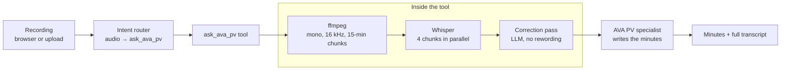

# Meeting minutes

A user records a meeting, or uploads a recording, and AVA returns structured minutes: agenda, decisions, actions with owners and deadlines.



We have not published the `ask_ava_pv` tool and the voice trigger filter yet. This page describes how they work, with the commands to build your own.

## How it works

1. **Capture.** The user uploads an audio or video file, or types "Ava, enregistre" in the chat. A filter then starts a recording in the browser; see [recording in the browser](#recording-in-the-browser).
2. **Routing.** The intent router sees an audio or video attachment, and always selects `ask_ava_pv`, even when the message is empty.
3. **Preparation.** The tool joins multi-part recordings, converts the audio to mono MP3 at 16 kHz and 64 kbit/s, and cuts it into 15-minute chunks.
4. **Language.** The meeting language is decided once, then forced on every chunk, so it cannot drift between chunks. Order of precedence: a valve, an explicit mention in the user's message ("séance en allemand"), then automatic detection on the first seconds.
5. **Transcription.** Four chunks are transcribed in parallel. Each request carries a biasing prompt: the names of participants and terms from the user's message, plus a list of organisation names and acronyms. Every proper noun given in the message is a correctly spelled noun in the minutes.
6. **Correction.** One model pass over the full transcript fixes homophones, names and punctuation. It must never reword. Doubtful passages become `[inaudible]`.
7. **Delegation.** The transcript goes to the `ava-pv` specialist, preceded by a "meeting information" block: meeting date, from the file's metadata or today, duration, and the current user, who is always listed as present.
8. **Result.** The specialist writes the minutes with [`system-prompts/ava-pv.md`](../system-prompts/ava-pv.md). The full transcript is attached as a DOCX file to the answer.

## Settings we use

| Setting | Value | Why |
|---|---|---|
| Chunk length | 900 seconds | Long enough for context, short enough to retry a failed chunk cheaply |
| Audio format | MP3, mono, 16 kHz, 64 kbit/s | What Whisper uses internally; small uploads |
| Parallel chunks | 4 | Fast without overloading the speech server |
| Timeout per chunk | 600 seconds, 2 retries | One slow chunk must not fail the whole meeting |
| Transcript limit | 120,000 characters | About two and a half hours of speech; protects the specialist's context |
| Progress heartbeat | Every 15 seconds | A status update keeps proxies from closing a long request |

## Build your own

The tool is ordinary Python, and needs `ffmpeg` and `ffprobe` in the Open WebUI image. The commands below are what the tool runs.

**1. Convert and cut the recording:**

```bash
ffmpeg -i meeting.m4a -vn -ac 1 -ar 16000 -b:a 64k \
  -f segment -segment_time 900 -reset_timestamps 1 chunk_%03d.mp3
```

**2. Read the duration and recording date** for the minutes' header:

```bash
ffprobe -v error -show_entries format=duration:format_tags=creation_time -of json meeting.m4a
```

**3. Transcribe each chunk** with any OpenAI-compatible speech server:

```bash
curl -s "$STT_URL/v1/audio/transcriptions" \
  -H "Authorization: Bearer $STT_API_KEY" \
  -F file=@chunk_000.mp3 \
  -F model=whisper-1 \
  -F language=fr \
  -F prompt="Séance du comité de projet. Participants : Marie Dupont, Jean Rossier. Termes : SCI, LIPDA."
```

Some hosted services, including Infomaniak's, transcribe asynchronously: the request returns a batch ID, and you poll for the result. Check your provider's documentation.

**4. Join the chunks** in order, then run the correction pass with a prompt such as:

```text
Corrige cette transcription automatique : orthographe des noms propres, homophones, ponctuation.
Ne reformule rien, ne résume rien, ne supprime rien. Remplace un passage incompréhensible par [inaudible].
Noms et termes connus : <participants et termes du message>.
```

**5. Delegate** to `ava-pv`, with the meeting information block first:

```text
Informations de séance
- Date de la réunion : 2026-10-14
- Durée de l'enregistrement : 1 h 12 min
- Utilisateur courant : Marie Dupont

Transcription :
…
```

You can do this last step with [`tools/ask_ava_specialist.py`](../tools/ask_ava_specialist.py): call its delegation method from your transcription tool, or put the transcript in the question.

## Recording in the browser

Our voice trigger filter lets users record without leaving AVA:

1. The user types "Ava, enregistre", optionally with the meeting's title, participants and agenda.
2. The filter answers with a consent notice and starts a `MediaRecorder` in the browser, in Opus at 48 kbit/s, through Open WebUI's event emitter.
3. Every 3 minutes, the recorded part is uploaded to `/api/v1/files/?process=false`. Uploading in parts avoids large uploads and ingress timeouts, and a closed browser tab loses at most the last part.
4. On **Stop**, the filter sends a message with the file IDs. The next turn forces `ask_ava_pv`.
5. After the minutes are written, the audio files are deleted.

The maximum recording length is 3 hours. Only the first part carries the audio container header, so the parts must be joined before conversion.

## Quality tips for users

The quality of the minutes depends first on the audio. No model makes up for a poor recording.

- **Each speaker says their name** when they first speak ("Ici Marie Dupont…").
- **Use a conference microphone** in the middle of the table, rather than a laptop in a corner. Avoid side conversations and people speaking over each other.
- **For online meetings, use the platform's own recording.** It has a clean signal per participant.
- **Give context in the message:** title, participants, agenda. It feeds the biasing prompt and the correction pass.
- **State the language if in doubt:** "séance en allemand" forces it.

## Data protection

A meeting recording is personal data, often sensitive. Before offering this feature:

- tell participants they are recorded, and record only with their agreement: our filter shows a consent notice;
- delete the audio after transcription, and decide how long transcripts and minutes are kept;
- list where the audio goes: the speech server is an external data flow if it runs at a provider;
- say clearly that the minutes are a draft, to be reviewed. The prompt adds a closing line for this.

## Next steps we are working on

- **Self-hosted transcription with Voxtral** (Mistral, Apache 2.0), clearly better than Whisper on French. Its API is OpenAI-compatible, so only the URL changes.
- **Speaker identification** (diarisation) with pyannote or WhisperX, producing `[SPEAKER_02 | 04:12] …` labels. The prompt already handles them. Combined with "each speaker says their name", it will let the minutes attribute statements to people.
