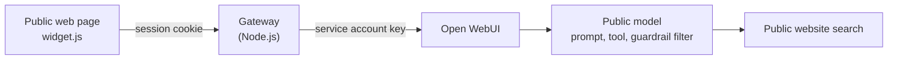

# Website chatbot

AVA also answers citizens on public web pages, for example on vehicle registration. The chatbot is an Open WebUI model like any other. Two things change: the users are anonymous, and the browser must never see an Open WebUI key.



- **The widget** is a script tag on the page. It shows the chat window and talks only to the gateway.
- **The gateway** holds the Open WebUI key, enforces the limits, and drives Open WebUI's API the same way the delegation tool does.
- **The public model** has its own prompt, a search tool limited to public pages, and a guardrail filter.

We have not published our gateway's code yet. This page describes its design, so that you can build your own.

## Step 1: Create the public model

In **Workspace > Models**, create a model such as `chatbot-vehicles`:

1. **Prompt.** Keep it short and strict. Ours has five rules:
   - answer in the visitor's language;
   - never give a legal assessment of a personal situation;
   - never generate a phone number, e-mail address or opening hours: link to the page that has them;
   - always link to the precise official page;
   - when in doubt, redirect to the service rather than guess.
2. **Tool.** A search over your public website only. Ours queries the website's own search engine, and returns titles, extracts and URLs.
3. **Guardrail filter.** Ours does the following:
   - inlet: detects legal or contentious questions and forces a fixed redirection answer; removes licence plate numbers from the question;
   - outlet: removes phone numbers and e-mail addresses the model may have written; checks every link and removes dead ones; switches links to the German pages for German-speaking visitors.
4. **No knowledge attached**, if the tool already searches the same pages: otherwise the same content is injected twice.
5. **Access:** only the gateway's service account.

**Check:** as an administrator, ask it a question in scope, one out of scope, and "Can I contest my fine?". The last one must get the redirection answer.

## Step 2: Create a service account

1. Create a dedicated Open WebUI user, for example `website-gateway`, with the role `user`.
2. Give it access to the public models only.
3. As an administrator, allow API keys for this account only, and create its key. Store the key in your secret manager.
4. Restrict what API keys can reach, with `ENABLE_API_KEYS_ENDPOINT_RESTRICTIONS=true` and `API_KEYS_ALLOWED_ENDPOINTS`. The gateway needs:

   | Endpoint | Used for |
   |---|---|
   | `GET /api/v1/models/model` | The model's tools and filters |
   | `POST /api/v1/chats/new`, `GET` and `POST /api/v1/chats/{id}` | Conversations |
   | `POST /api/chat/completions` | The answer |
   | `POST /api/chat/completed` | Outlet filters, such as the guardrail |
   | `POST /api/v1/evaluations/feedback` | Thumbs up and down, if you collect them |

   Check how your Open WebUI version matches these paths, and test with the key before going live.

Conversations are stored under the service account, so you can review them in Open WebUI. Decide their retention like any other personal data: visitors may write their name or situation.

## Step 3: Build the gateway

The gateway is a small web service between the widget and Open WebUI. Ours is about 1,500 lines of Node.js with Express, `helmet`, `cors` and `express-rate-limit`. These are the controls that matter:

| Control | Our value | Why |
|---|---|---|
| Allowed origins | Required at start-up | Only your pages can call the gateway |
| Allowed models | Required at start-up | The browser chooses among public models only |
| Session | Random 256-bit cookie, `HttpOnly`, `Secure`, `SameSite=Lax`; only its SHA-256 hash is stored | A stolen database or log reveals no usable session |
| Session lifetime | 1 hour idle, 2 hours maximum | Anonymous sessions should not live long |
| Concurrent answers | A total cap, sized from your model capacity, and 1 per session | Protects the model capacity used by staff |
| Request rate | Per IP and per session; the per-IP limit stays generous, because many visitors share an IP behind a proxy | Limits abuse and runaway scripts |
| Message length | 4,000 characters; history of 6 turns | Bounds cost and prompt size |
| Request body | 128 kB | Rejects uploads and junk early |
| Logging | Never the messages, never the chat IDs | Visitors write personal data |

Hold a concurrency slot until the upstream stream has ended, not just until the first byte. Otherwise the limit does not hold under load.

Set the concurrency and rate values from a load test of your own setup, and keep them in your deployment configuration rather than in public documentation: they tell an attacker how much traffic saturates the service.

The flow for one question is the delegation flow from the [architecture](architecture.md#how-delegation-works). This sketch shows it without the session store, limits and error handling a public service needs:

```js
// Sketch only: one question, no history, no sessions, no limits.
import express from "express";
import crypto from "node:crypto";

const OWUI = process.env.OPENWEBUI_URL; // for example http://open-webui:8080, inside the cluster
const headers = { Authorization: `Bearer ${process.env.OPENWEBUI_API_KEY}`, "Content-Type": "application/json" };
const ORIGINS = new Set(process.env.ALLOWED_ORIGINS.split(","));
const MODELS = new Set(process.env.PUBLIC_MODELS.split(","));
const sleep = (ms) => new Promise((resolve) => setTimeout(resolve, ms));

async function owui(path, body) {
  const res = await fetch(OWUI + path, body ? { method: "POST", headers, body: JSON.stringify(body) } : { headers });
  if (!res.ok) throw new Error(`${path}: HTTP ${res.status}`);
  return res.json();
}

// Recent Open WebUI versions store the answer in output[], not only in content.
function answerText(message) {
  for (const item of [...(message.output ?? [])].reverse()) {
    if (item.type !== "message") continue;
    const text = (item.content ?? []).filter((p) => p.type === "output_text").map((p) => p.text).join("\n\n");
    if (text.trim()) return text.trim();
  }
  return (message.content ?? "").trim();
}

async function ask(model, question) {
  // API completions do not apply the model's tools and filters: pass them explicitly.
  const record = await owui(`/api/v1/models/model?id=${encodeURIComponent(model)}`);
  const meta = (record.info ?? record).meta ?? {};
  const [u, a] = [crypto.randomUUID(), crypto.randomUUID()];
  const now = Math.floor(Date.now() / 1000);
  const user = { id: u, role: "user", content: question, timestamp: now, models: [model], childrenIds: [a] };
  const assistant = { id: a, role: "assistant", content: "", parentId: u, childrenIds: [], model, done: false, timestamp: now + 1 };
  const chat = await owui("/api/v1/chats/new", {
    chat: { models: [model], messages: [user, assistant], history: { currentId: a, messages: { [u]: user, [a]: assistant } } },
  });
  const run = {
    chat_id: chat.id, id: a, session_id: crypto.randomUUID(), model, stream: true,
    messages: [{ role: "user", content: question }],
    tool_ids: meta.toolIds ?? [], filter_ids: meta.filterIds ?? [], function_calling: "native",
    background_tasks: { title_generation: false, tags_generation: false, follow_up_generation: false },
  };
  await fetch(OWUI + "/api/chat/completions", { method: "POST", headers, body: JSON.stringify(run) }).then((r) => r.text());
  for (let i = 0; i < 90; i++) {
    const message = (await owui(`/api/v1/chats/${chat.id}`)).chat.history.messages[a] ?? {};
    if (message.done && answerText(message)) {
      const text = answerText(message);
      // Runs the outlet filters, including the guardrail, and returns their result.
      const done = await owui("/api/chat/completed", { chat_id: chat.id, id: a, model, filter_ids: run.filter_ids,
        messages: [{ id: u, role: "user", content: question }, { id: a, role: "assistant", content: text }] });
      return done.messages?.at(-1)?.content ?? text;
    }
    await sleep(1000);
  }
  throw new Error("timeout");
}

const app = express();
app.use(express.json({ limit: "128kb" }));
app.post("/api/chat", async (req, res) => {
  const origin = req.get("Origin");
  if (!ORIGINS.has(origin)) return res.status(403).end();
  res.set({ "Access-Control-Allow-Origin": origin, Vary: "Origin" });
  const { modelId, message } = req.body ?? {};
  if (!MODELS.has(modelId) || typeof message !== "string" || !message.trim() || message.length > 4000) {
    return res.status(400).json({ error: "invalid request" });
  }
  try {
    res.json({ answer: await ask(modelId, message) });
  } catch {
    res.status(502).json({ error: "unavailable" }); // never log the message
  }
});
app.listen(8080);
```

Our gateway adds:

- history per session and per page, so a visitor can ask follow-up questions;
- a `GET /api/status` endpoint returning green, yellow, orange or red from the current load, so the widget can warn visitors before they wait;
- thumbs up and down sent to Open WebUI's evaluations, with a snapshot of the chat, so the feedback appears in **Admin Panel > Evaluations**;
- French and German error messages.

### Lessons from building it

- **Open WebUI's Socket.IO events need a user session token (JWT), not an `sk-` API key.** Polling the chat works with the API key, and is enough for a chatbot.
- **Read the answer from `output[]`,** along the branch `history.currentId` → `parentId`, not from `chat.messages`.
- **Pass the model's `tool_ids` and `filter_ids` explicitly, and call `/api/chat/completed`.** Otherwise the guardrail's outlet never runs.
- **Behind a proxy, Node's `fetch` ignores `HTTP(S)_PROXY` by default.** Recent Node releases honour them with `NODE_USE_ENV_PROXY=1`; on older ones, set undici's `EnvHttpProxyAgent` as the global dispatcher. Check which applies to your Node version. Behind TLS inspection, add your CA with `NODE_EXTRA_CA_CERTS`, because Node ignores the system trust store.
- **Set a route timeout longer than your longest answer.** We use 10 minutes on the gateway's route.

## Step 4: Embed the widget

```html
<script
  src="https://chat-gateway.example.org/widget/ava-widget.js"
  data-model-id="chatbot-vehicles"
  data-ava-language="fr"
  data-ava-show-rating="true"
  data-ava-compliance-url="https://www.example.org/privacy"
></script>
```

The widget is a single vanilla JavaScript file, with no framework. It sends the session cookie with `credentials: "include"`, so the gateway's CORS policy must allow credentials for your origins only.

**Before going live:**

- [ ] The page states that answers are generated by AI, and links to a privacy notice
- [ ] Out-of-scope, legal and abusive questions have been tested, in each language
- [ ] The gateway's limits have been tested under load
- [ ] Logs contain no message content
- [ ] Retention of the service account's chats is set and enforced
